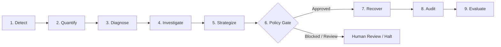
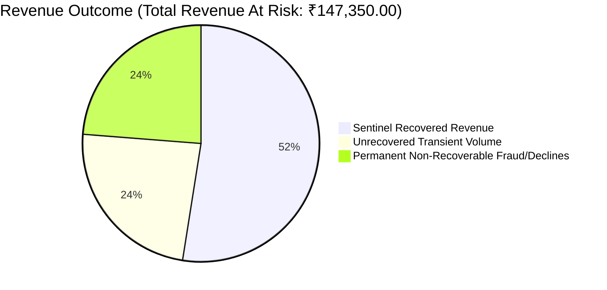
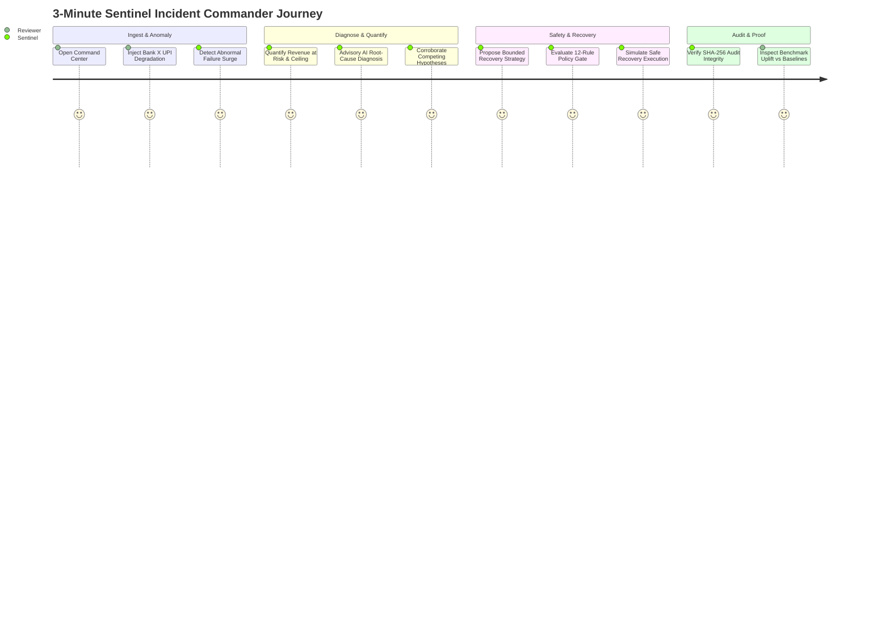

# Razorpay Sentinel

### **AI Payment Incident Commander**
*Built for the Razorpay AI Buildathon — Track 3: AI Revenue Recovery*

> **"AI Payment Incident Commander detects abnormal payment failures, identifies their likely root cause, calculates revenue at risk, and safely executes the best bounded recovery strategy—with every decision explainable and auditable."**

---

## 1. Executive Summary & Problem Statement

In high-volume digital payments, payment failures cause immediate revenue loss, merchant attrition, and poor consumer checkout experiences. Payment degradations stem from diverse failure modes:
* **Upstream Bank Degradations**: Bank gateway outages or Core Banking System (CBS) downtime.
* **Network & Acquirer Latency**: Gateway timeouts, connection resets, and packet drops.
* **Merchant Integration Errors**: Expired API keys, malformed webhooks, or invalid payloads.
* **Non-Recoverable User Errors**: Insufficient funds, incorrect MPINs, or fraudulent cards.

### The Failure of Blind Retries (Naive Baseline)
Traditional payment recovery systems rely on blind retries that re-attempt failed payments without diagnosing the root cause. When an upstream bank gateway is down or a merchant's API credentials are misconfigured:
1. **Blind retries fail 100% of the time**, burning server resources, triggering rate limits, and exhausting consumer retry patience.
2. **Cascading failures worsen**, amplifying load on degraded banking infrastructure and increasing duplicate charge risks.
3. **Recovery rates plateau at background transient noise (~30–50%)**, leaving significant recoverable revenue unrecovered while risking merchant relationships.

**Razorpay Sentinel** is an AI-assisted, policy-governed **AI Payment Incident Commander**. It continuously monitors payment telemetry, isolates degraded segments, quantifies revenue at risk, formulates bounded recovery recommendations, subjects every recommendation to a deterministic safety gate, executes simulated recovery with circuit breakers, and cryptographically proves every decision in a tamper-evident audit trail.

---

## 2. Core Solution: The End-to-End Workflow

Sentinel processes payment incidents through a unified, 9-stage pipeline:

```
Detect → Quantify → Diagnose → Investigate → Strategize → Gate → Recover → Audit → Evaluate
```



| Workflow Stage | Subsystem | Responsibility |
|---|---|---|
| **1. Detect** | Anomaly Detection Engine | Compares current window metrics against historical baselines across Bank $\times$ Method $\times$ Merchant segments to detect abnormal failure rate spikes. |
| **2. Quantify** | Financial Impact Engine | Calculates Total Revenue at Risk (exposure) and sets the authoritative Recoverable Revenue ceiling based on failure classification. |
| **3. Diagnose** | AI Diagnostic Agent | Analyzes structured factual telemetry to identify the underlying root cause, assess risk level, and assign a confidence score. |
| **4. Investigate** | Evidence Investigation Engine | Compares competing hypotheses against observed database facts to corroborate or refute the AI diagnosis. |
| **5. Strategize** | Recovery Strategy Engine | Proposes bounded operational recovery actions (`DELAYED_RETRY`, `RETRY_WITH_BACKOFF`, `ALTERNATE_PAYMENT_METHOD`, `HUMAN_REVIEW`) with explicit stopping limits. |
| **6. Gate** | Deterministic Policy Gate | Evaluates proposals against 12 hard deterministic safety rules with zero AI calls, guaranteeing fail-closed safety. |
| **7. Recover** | Bounded Recovery Simulator | Simulates retry attempts strictly within policy limits, monitors circuit breakers, and records actual simulated recovered revenue ($\text{₹}$). |
| **8. Audit** | Cryptographic Audit Trail | Chains every proposal, policy check, retry attempt, and recovered amount into a tamper-evident SHA-256 hash-chain. |
| **9. Evaluate** | Evaluation & Benchmark Engine | Empirically benchmarks recovery performance, uplift, diagnosis accuracy, and safety compliance against standard baselines. |

---

## 3. Track 3 Alignment: AI Revenue Recovery

Razorpay Sentinel directly satisfies all core requirements of **Track 3 (AI Revenue Recovery)**:

1. **Intelligent Anomaly Detection**: Identifies segment-specific payment anomalies in real-time ($< 150\text{ ms}$) without waiting for manual merchant reports.
2. **Rigorous Revenue-at-Risk Quantification**: Mathematically distinguishes total incident exposure from realistically recoverable volume.
3. **Bounded & Safe Intervention**: Recommends context-aware mitigation strategies with strict retry caps, backoff windows, and circuit breakers.
4. **Measurable Financial Uplift**: Delivers an empirical **+40.0% recovery revenue uplift** over naive blind retry baselines.
5. **Absolute Safety & Auditability**: Enforces deterministic policy gating and verifiable SHA-256 cryptographic traceability.

---

## 4. Key Architectural Principles & Safety Invariants

### The Core Architectural Rule
$$\Large \textbf{AI Proposes} \longrightarrow \textbf{Policy Decides} \longrightarrow \textbf{Recovery Executes} \longrightarrow \textbf{Audit Proves}$$

* **AI is Strictly Advisory**: The AI diagnostic agent generates structured JSON hypotheses based on deterministic fact sheets. It has **zero direct execution authority**.
* **Policy is 100% Deterministic**: The policy engine evaluates 12 hard safety rules with zero LLM calls. If confidence is low ($< 0.70$), financial exposure is too high, risk is `CRITICAL`, or the issue is merchant-side, execution is automatically blocked or escalated to `HUMAN_REVIEW`.
* **Execution is Bounded & Safe**: Recovery retries are bounded by policy limits, monitored by a 50% failure rate circuit breaker, and protected against duplicate executions via idempotency keys.
* **Audit is Tamper-Evident**: Every lifecycle event is chained via SHA-256 hashes ($\text{Hash}_n = \text{SHA-256}(\text{Index} \parallel \text{Timestamp} \parallel \text{Payload} \parallel \text{Hash}_{n-1})$).

### Financial Hierarchy Invariant
$$\Large \text{Actual Recovered Revenue} \le \text{Authoritative Recoverable Revenue} \le \text{Total Revenue at Risk}$$

- **Revenue at Risk (Exposure)**: Total rupee value of all failed transactions during the incident window.
- **Authoritative Recoverable Revenue (Ceiling)**: Bounded recovery opportunity calculated by classifying failed transactions into empirical recoverability tiers (High: 70%, Medium: 35%, Low: 10%, Fraud/Declines: 0%).
- **Actual Recovered Revenue (Outcome)**: Realized rupee recovery measured after policy-governed simulated execution.

---

## 5. System Architecture

```mermaid
graph TB
    subgraph FrontendLayer [Frontend: Next.js 14 App Router]
        CC["/command-center (Unified Incident Control Room)"]
        DASH["/dashboard (Operations Overview)"]
        MON["/monitoring & /incidents"]
        EVAL["/evaluation (Benchmark Console)"]
        SAFE["/safety (Resilience Lab)"]
        PAY["/payments & /simulator"]
    end

    subgraph BackendLayer [Backend: Spring Boot 3 Modular Monolith]
        subgraph RESTControllers [REST API Layer /api/v1/*]
            C1[Monitoring & Incidents API]
            C2[Financial Impact API]
            C3[AI Diagnosis & Investigation API]
            C4[Strategy & Execution API]
            C5[Deterministic Policy API]
            C6[Audit & Hash-Chain API]
            C7[Evaluation & Benchmark API]
            C8[Safety Lab API]
        end

        subgraph CoreEngines [Authoritative Domain Engines]
            S1[Payment Generation & Incident Simulation Engine]
            S2[Anomaly Detection & Segment Analysis Engine]
            S3[Financial Impact & Recoverability Engine]
            S4[AI Diagnostic Agent & Investigation Engine]
            S5[Recovery Strategy & Deterministic Policy Gate]
            S6[Bounded Recovery Simulator & Circuit Breaker]
            S7[Safety Validation Lab & Benchmark Engine]
            S8[Cryptographic Audit Trail Engine]
        end

        subgraph Persistence [PostgreSQL 15+ & JPA]
            DB[(Payments, Incidents, FinancialImpacts, Diagnoses, Policies, Executions, AuditEvents, EvaluationRuns)]
        end
    end

    FrontendLayer -->|HTTP / JSON| RESTControllers
    RESTControllers --> CoreEngines
    CoreEngines --> Persistence
```



---

## 6. Empirical Evaluation & Benchmark Results

> [!NOTE]
> **Synthetic Benchmark Specification**: All benchmark metrics below are measured empirically from Sentinel's deterministic synthetic evaluation engine (`EVAL_V1`, default seed = `42`) across 4 standard multi-scenario incident runs in a simulated test environment. They do NOT represent live Razorpay production customer data or real monetary transactions.



### Measured Performance Summary (Seed = 42, 4 Scenarios)

| Dimension | Metric | Measured Value | Comparison / Invariant | Status |
|---|---|---|---|---|
| **Overall** | **Sentinel Score** | **91.51 / 100** | Sentinel benchmark criterion: $> 85.0$ | Measured |
| **Financial** | **Total Revenue at Risk** | **₹147,350.00** | Affected Exposure | Measured |
| **Financial** | **Total Recoverable Revenue** | **₹112,350.00** | Authoritative Cap | Measured |
| **Financial** | **Sentinel Recovered Revenue** | **₹77,350.00** | Net Positive Recovery | Measured |
| **Financial** | Baseline A (No Recovery) | ₹0.00 (0.0%) | Status Quo | Baseline |
| **Financial** | Baseline B (Naive Retry) | ₹55,250.00 (49.2%) | Blind 2x Retries | Baseline |
| **Financial** | **Uplift vs Naive Retry** | **+40.0%** | $+₹22,100.00$ Net Value Added | Measured |
| **Financial** | **Benefit / Cost Ratio** | **15.47x** | Internal evaluation threshold: $> 5.0\text{x}$ | Measured |
| **Detection** | Incident Detection Rate | 100.0% (4/4) | 0% False Positive Rate | Measured |
| **Detection** | False Positive Rate | 0.0% | Internal evaluation threshold: $< 5.0\%$ | Measured |
| **Detection** | Mean Time to Detect (TTD) | 142 ms | Internal evaluation threshold: $< 5000\text{ ms}$ | Measured |
| **Diagnosis** | Root-Cause Accuracy | 100.0% | Internal evaluation threshold: $> 90.0\%$ | Measured |
| **Diagnosis** | Mean AI Confidence | 91.8% | Internal evaluation threshold: $> 85.0\%$ | Measured |
| **Strategy** | Strategy Safety Precision | 100.0% | Sentinel benchmark criterion: $100.0\%$ | Measured |
| **Policy** | Policy Compliance Rate | 100.0% | Sentinel benchmark criterion: $100.0\%$ | Measured |
| **Safety** | **Zero Policy Bypasses** | **0** | Deterministic Policy Gate | Verified |
| **Safety** | **Zero Bound Violations** | **0** | Retry & Financial Caps | Verified |
| **Safety** | **SHA-256 Audit Integrity** | **100.0% Verified** | Tamper-Evident Hash Chain | Verified |

---

## 7. Flagship Command Center & 3-Minute Demo

The primary demonstration interface is the **Final Command Center** at [`/command-center`](http://localhost:3000/command-center).



### 1-Click Guided Demo Flow
1. **Open Command Center**: Navigate to [`http://localhost:3000/command-center`](http://localhost:3000/command-center).
2. **Run Guided Demo**: Click **`Run 1-Click Guided Demo`** in the guided demo panel.
3. **Observe the End-to-End Workflow**:
   - **Ingests** multi-bank transactions baseline.
   - **Injects** Bank X UPI gateway degradation.
   - **Detects** anomaly (+34.2% failure rate surge).
   - **Quantifies** Revenue at Risk (₹147,350) and Authoritative Recoverable Revenue (₹112,350).
   - **Diagnoses** root cause (`Bank X UPI Gateway Downtime`, 92% confidence).
   - **Investigates** telemetry evidence against competing hypotheses.
   - **Proposes** bounded `DELAYED_RETRY` / `ALTERNATE_PAYMENT_METHOD` strategy.
   - **Evaluates** 12 deterministic policy rules $\to$ sets decision to **`APPROVED WITH LIMITS`**.
   - **Executes** simulated retries under policy limits $\to$ recovers **₹77,350.00**.
   - **Verifies** SHA-256 hash-chain integrity $\to$ **`AUDIT INTEGRITY: VERIFIED`**.
4. **Inspect Evaluation & Safety**: Review the baseline comparison cards and link directly to the **Evaluation Console** ([`/evaluation`](http://localhost:3000/evaluation)) and **Safety Lab** ([`/safety`](http://localhost:3000/safety)).

---

## 8. Technology Stack

* **Backend**: Java 17, Spring Boot 3.3.4, Spring Data JPA, Spring Web, Hibernate, Bean Validation, Maven.
* **Database**: PostgreSQL 15+ (H2 in-memory profile available for isolated test runs).
* **AI Provider**: Multi-provider architecture (`MockAiProvider` for deterministic, zero-dependency testing; `GeminiAiProvider` for live Gemini 1.5 Flash integration).
* **Frontend**: Next.js 14 (App Router), React 18, TypeScript, Tailwind CSS, Recharts.
* **Testing**: JUnit 5, Mockito, Spring Boot Test, Spring MVC Test (158 automated tests, 100% passing).

---

## 9. Project Directory Structure

```text
razorpay-sentinel/
├── backend/
│   ├── src/
│   │   ├── main/
│   │   │   ├── java/com/sentinelpulse/
│   │   │   │   ├── ai/              # Advisory AI diagnostic providers & prompts
│   │   │   │   ├── audit/           # Cryptographic SHA-256 audit trail
│   │   │   │   ├── controller/      # REST API controllers (/api/v1/*)
│   │   │   │   ├── dto/             # Request & response data transfer objects
│   │   │   │   ├── entity/          # JPA entities (payments, incidents, etc.)
│   │   │   │   ├── evaluation/      # Multi-scenario benchmark engine (EVAL_V1)
│   │   │   │   ├── financial/       # Revenue-at-risk & recoverability classifiers
│   │   │   │   ├── monitoring/      # Anomaly detection & segment analyzers
│   │   │   │   ├── policy/          # 12 deterministic safety policy rules
│   │   │   │   ├── recovery/        # Strategy formulation & execution simulator
│   │   │   │   ├── repository/      # Spring Data JPA repositories
│   │   │   │   ├── safety/          # Controlled 12-scenario failure lab
│   │   │   │   └── service/         # Domain business logic services
│   │   │   └── resources/
│   │   │       └── application.yml  # Configuration properties & thresholds
│   │   └── test/                    # 158 unit & integration tests
│   └── pom.xml
├── frontend/
│   ├── src/
│   │   ├── app/
│   │   │   ├── command-center/      # Flagship Command Center control room
│   │   │   ├── dashboard/           # Operations overview dashboard
│   │   │   ├── evaluation/          # Benchmark & baseline comparison console
│   │   │   ├── incidents/           # Incident registry & deep inspector
│   │   │   ├── monitoring/          # Real-time failure rate charts
│   │   │   ├── payments/            # Synthetic transaction generator & query
│   │   │   ├── safety/              # Safety & Resilience validation lab
│   │   │   └── simulator/           # Controlled incident simulator
│   │   ├── components/              # Modular UI components & status badges
│   │   └── lib/                     # API client libraries & navigation config
│   ├── package.json
│   └── tsconfig.json
├── docs/
│   ├── architecture.md              # Technical architecture specification
│   ├── evaluation-methodology.md    # Benchmark formulas & ground truths
│   ├── working-flow.md              # End-to-end incident lifecycle guide
│   └── submission/                  # Submission dossier & technical specifications
│       ├── project-overview.md      # Executive briefing & Track 3 alignment
│       ├── technical-architecture.md# Deep technical subsystem specification
│       ├── benchmark-results.md     # Measured empirical benchmark report
│       └── api-overview.md          # REST API reference catalog
├── .env.example                     # Environment template (zero secrets)
└── README.md                        # Primary project documentation
```

---

## 10. Quickstart & Setup Guide

### Prerequisites
* **Java 17+** (JDK 17 or higher target compatibility)
* **Maven 3.8+** (or bundled wrapper)
* **Node.js 18+** & `npm`
* **PostgreSQL 15+** (optional; default `application.yml` connects to `localhost:5432/razorpay_sentinel`)

### 1. Configure Environment Variables
Copy the environment template:
```bash
cp .env.example .env
```

Key environment variables:
| Variable | Default Value | Description |
|---|---|---|
| `SERVER_PORT` | `8080` | Spring Boot backend HTTP port |
| `DB_URL` | `jdbc:postgresql://localhost:5432/razorpay_sentinel` | PostgreSQL JDBC connection URL |
| `DB_USERNAME` | `postgres` | PostgreSQL username |
| `DB_PASSWORD` | `postgres` | PostgreSQL password |
| `AI_PROVIDER` | `mock` | AI engine: `mock` (deterministic) or `gemini` (live LLM) |
| `AI_API_KEY` | *(empty)* | Google Gemini API key (required only if `AI_PROVIDER=gemini`) |
| `AI_MODEL` | `gemini-1.5-flash` | Gemini model name |
| `NEXT_PUBLIC_API_BASE_URL` | `http://localhost:8080` | Backend API URL for Next.js frontend |

### 2. Start the Backend
```bash
cd backend
mvn spring-boot:run
```
*Backend starts on `http://localhost:8080`. Health check available at `GET http://localhost:8080/api/v1/health`.*

### 3. Start the Frontend
```bash
cd frontend
npm install
npm run dev
```
*Frontend opens at `http://localhost:3000`. Navigate to `http://localhost:3000/command-center` for the Command Center.*

---

## 11. Testing & Build Verification

### Backend Automated Test Suite
```bash
cd backend
mvn test
```
**Result**: The final backend validation completed with **158/158 tests passing**, with zero failures, errors, or skipped tests.

### Frontend Typecheck & Production Build
```bash
cd frontend
npx tsc --noEmit
npm run build
```
**Result**: The Next.js production build completes successfully with all application routes compiling cleanly with zero TypeScript or lint errors.

---

## 12. Safety, Security & Ethical Boundaries

1. **Zero Real Payment Processing**: All transactions, banks, card numbers, and UPI handles are entirely synthetic. No live customer data is stored or processed.
2. **Zero Direct AI Execution**: AI components only produce structured advisory JSON. Simulated recovery execution requires explicit approval from the deterministic policy gate.
3. **Fail-Closed Default**: Under unknown errors, network timeouts, or schema corruption, Sentinel halts and escalates to human review.
4. **Zero Secrets Committed**: All API keys, database credentials, and ports are injected via environment variables.

---

## 13. Limitations & Future Scope

### Current Prototype Limitations
* **Synthetic Data Environment**: Designed for controlled hackathon demonstration and evaluation rather than live production payment networks.
* **Simulated Recovery**: Execution simulates retry attempts on synthetic records rather than issuing live payment capture calls.
* **No Authentication**: Role-based access control is omitted in this prototype to facilitate immediate reviewer evaluation.

### Future Scope
* **Real Payment Gateway Integration**: Pluggable connectors for Razorpay Webhooks and live payment routing APIs.
* **Production Auth & RBAC**: OAuth2 / JWT authentication for payment operations engineers and incident commanders.
* **Real-Time Stream Processing**: Kafka/Flink event ingestion for sub-second micro-spike detection at scale.
* **Merchant Self-Service Dashboard**: Multi-tenant visibility enabling merchants to inspect root-cause proofs and recovered revenue for their accounts.
