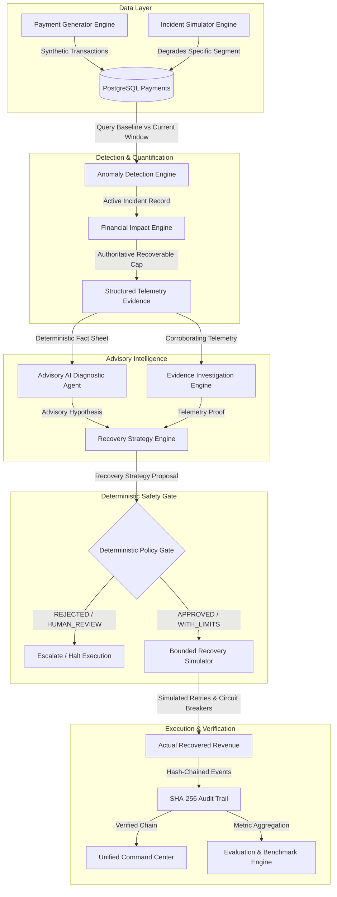

# System Architecture

Razorpay Sentinel is engineered as a **modular monolith** (Java 17, Spring Boot 3, Next.js 14, PostgreSQL). Detection, financial quantification, advisory AI diagnosis, root-cause investigation, deterministic policy gating, bounded recovery simulation, and cryptographic audit validation all reside in a single, traceable backend service.

---

## 1. System Pipeline Architecture

```text
Normal path:
Detect → Quantify → Diagnose → Investigate → Strategize → Gate → Recover → Audit → Evaluate

Failure path:
Anomaly / Injected Failure → Guardrail Triggered → Closed / Blocked / Escalated → Audit Recorded
```



---

## 2. Core Architectural Boundaries

Sentinel operates on four strict architectural boundaries:

1. **AI Boundary (Advisory Only)**:
   $$\textbf{AI Proposes}$$
   The AI Diagnostic Agent analyzes structured deterministic telemetry fact sheets and generates diagnosis hypotheses and bounded recovery proposals. AI outputs are strictly schema-validated. The AI has **zero direct execution authority**.
2. **Policy Boundary (100% Deterministic Gate)**:
   $$\textbf{Policy Decides}$$
   The Deterministic Policy Gate evaluates proposals against 12 hard safety rules with **zero AI calls**. If confidence is low ($< 0.70$), financial exposure is too high, risk is `CRITICAL`, or the degradation is merchant-side, execution is automatically blocked or escalated to `HUMAN_REVIEW`.
3. **Execution Boundary (Bounded & Protected)**:
   $$\textbf{Recovery Executes}$$
   The Recovery Execution Simulator only executes if the Policy Gate has explicitly issued an approval. Execution is bounded by maximum retry caps, guarded by a 50% failure rate circuit breaker, protected by idempotency keys, and capped by authoritative recoverable revenue.
4. **Audit Boundary (Tamper-Evident Proof)**:
   $$\textbf{Audit Proves}$$
   Every proposal, policy decision, retry attempt, and recovered amount is sequentially linked in a cryptographic SHA-256 hash-chain.

---

## 3. Financial Hierarchy Invariant

$$\Large \text{Actual Recovered Revenue} \le \text{Authoritative Recoverable Revenue} \le \text{Total Revenue at Risk}$$

* **Revenue at Risk (Exposure)**: Total rupee value of all failed transactions during the incident window (calculated by the Financial Impact Engine).
* **Authoritative Recoverable Revenue (Ceiling)**: Bounded recovery opportunity calculated by classifying failed transactions into empirical recoverability tiers (High: 70%, Medium: 35%, Low: 10%, Fraud/Declines: 0%).
* **Actual Recovered Revenue (Outcome)**: Realized rupee recovery measured after policy-governed simulated execution.

---

## 4. Subsystem Specifications

### 1. Payment Data & Incident Simulation Engine
* **Component**: `PaymentGeneratorService`, `IncidentSimulationService`, `PaymentRepository`
* Generates realistic, weighted synthetic payment traffic across UPI, Cards, NetBanking, and Wallets for major banks (HDFC, ICICI, SBI, Axis, Kotak).
* Injects reproducible degradation scenarios (`BANK_X_UPI_DEGRADATION`, `MERCHANT_SPECIFIC_DEGRADATION`, `NORMAL_RANDOM_FAILURES`, `GATEWAY_TIMEOUT_DEGRADATION`) with lossless reset support.

### 2. Anomaly Detection & Segment Analysis Engine
* **Component**: `IncidentDetectionService`, `SegmentAnalyzer`, `PaymentStatistics`
* Computes baseline-vs-current failure rates across multidimensional segments (Bank $\times$ Method $\times$ Merchant).
* Generates `Incident` records with duplicate suppression to prevent alert fatigue. Root cause is left unset for downstream diagnostic validation.

### 3. Financial Impact & Recoverability Classification Engine
* **Component**: `FinancialImpactService`, `RecoverabilityClassifier`
* Classifies errors into recoverability tiers based on technical characteristics (e.g. transient network timeouts vs permanent card declines).
* Serves as the sole authoritative financial source for downstream recovery bounds.

### 4. Advisory AI Diagnostic Agent
* **Component**: `AiDiagnosticService`, `MockAiProvider`, `GeminiAiProvider`
* Consumes structured `IncidentEvidenceDto` containing deterministic facts (failure rates, error distributions, affected banks, latency deltas).
* Returns structured JSON diagnoses with confidence scores and risk levels. Fails closed safely if JSON is unparseable or LLM times out.

### 5. Competing Root-Cause Investigation Engine
* **Component**: `IncidentInvestigationService`
* Systematically compares competing hypotheses against observed telemetry facts to corroborate or refute the AI diagnosis.
* Strictly distinguishes database telemetry facts from AI inference.

### 6. Recovery Strategy Formulation Engine
* **Component**: `RecoveryStrategyService`
* Formulates bounded recovery proposals (`DELAYED_RETRY`, `RETRY_WITH_BACKOFF`, `ALTERNATE_PAYMENT_METHOD`, `HUMAN_REVIEW`, `NO_ACTION`) with explicit stopping conditions and maximum retry counts.
* Caps expected recovery estimates to authoritative recoverable revenue.

### 7. Deterministic Policy Gate & Safety Guardrails
* **Component**: `PolicyEvaluationService` (Zero AI calls)
* Evaluates proposals against **12 hard safety policies**:
  - `POLICY-001`: Strategy Validity Check
  - `POLICY-002`: Confidence Threshold ($\ge 0.70$ for automated execution)
  - `POLICY-003`: Maximum Financial Exposure Limit ($\le \text{₹500,000}$)
  - `POLICY-004`: Critical Risk Exclusion (Forces `HUMAN_REVIEW`)
  - `POLICY-005`: Merchant Protection Guard (Forces `HUMAN_REVIEW` / `REJECTED`)
  - `POLICY-006`: Maximum Retry Attempt Limit (Max 3 retries per payment)
  - `POLICY-007`: Circuit Breaker Threshold (Halt if failure rate $> 50\%$)
  - `POLICY-008`: Active Incident State Verification (Cannot recover resolved incidents)
  - `POLICY-009`: Strategy Freshness Guard (Rejects proposals $> 30$ minutes old)
  - `POLICY-010`: Recoverability Ceiling Enforcement
  - `POLICY-011`: Action Whitelist Check
  - `POLICY-012`: Human Review Escalation Compliance

### 8. Bounded Recovery Execution Simulator
* **Component**: `RecoveryExecutionService`
* Simulates retry attempts for failed transactions strictly within policy-approved bounds.
* Enforces circuit breakers (halts if failure rate $> 50\%$) and idempotency keys to prevent duplicate recovery runs.

### 9. Cryptographic Audit Trail Engine
* **Component**: `AuditEventService`, `AuditVerificationService`
* Records every incident lifecycle event into a tamper-evident SHA-256 hash-chain:
  $$\text{Hash}_n = \text{SHA-256}(\text{Index} \parallel \text{Timestamp} \parallel \text{EventType} \parallel \text{PayloadHash} \parallel \text{Hash}_{n-1})$$
* Verifies hash integrity on demand, detecting any database modification or row deletion.

### 10. Safety Validation Lab
* **Component**: `SafetyScenarioService`
* Executes **12 controlled failure scenarios** proving that Sentinel fails closed under AI downtime, JSON schema corruption, low confidence, policy rejections, stale strategies, and audit tampering.

### 11. Empirical Evaluation & Benchmarking Engine (`EVAL_V1`)
* **Component**: `EvaluationService`
* Executes seeded multi-scenario benchmarks comparing Sentinel against Ground Truth, **Baseline A (No Recovery = ₹0)**, and **Baseline B (Naive Retry)**.
* Aggregates 25+ metrics across Financial Effectiveness, Detection & Latency, Diagnostic Accuracy, and Policy/Safety Compliance.

### 12. Flagship Unified Command Center
* **Component**: `frontend/src/app/command-center/page.tsx`
* Consolidated control room providing real-time subsystem telemetry, financial impact hierarchy, 8-stage operational decision pipeline, 6-card diagnostic grid, safety proofs, and a 10-step Guided Demo runner.

---

## 5. Persistence Schema Overview

All relational entities are persisted in PostgreSQL:
* `payments`: Synthetic transaction stream (amount, status, bank, payment_method, error_code, timestamp).
* `incidents`: Detected incident records (type, severity, status, baseline/current failure rates, affected volume).
* `financial_impacts`: Quantified financial exposure and recoverability tier breakdown.
* `ai_diagnoses`: Cached advisory AI diagnoses, confidence scores, and risk ratings.
* `incident_investigations`: Competing hypothesis proofs and corroborating evidence.
* `recovery_strategies`: Proposed recovery actions, stopping conditions, and financial estimates.
* `policy_evaluations`: Deterministic policy decisions (`APPROVED`, `APPROVED_WITH_LIMITS`, `HUMAN_REVIEW`, `REJECTED`) and applied limits.
* `recovery_executions`: Simulated recovery outcomes, transaction counts, recovered amounts, and circuit breaker states.
* `audit_events`: SHA-256 hash-chained chronological decision log.
* `evaluation_runs`: Persisted multi-scenario benchmark summaries and per-incident metrics.
