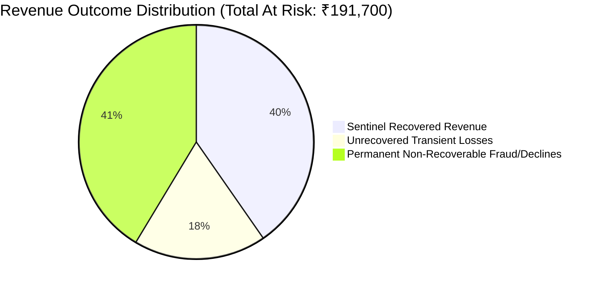

# Razorpay Sentinel — Empirical Benchmark Results

**Evaluation Engine Version**: `EVAL_V1`  
**Dataset Condition**: Deterministic Synthetic Multi-Scenario Benchmark (Default Seed = `42`)  
**Scope**: 4 Standard Evaluation Scenarios with Known Ground Truth

> [!NOTE]
> **Synthetic Benchmark Specification**: All results in this report are measured empirically from Sentinel's deterministic synthetic evaluation engine (`EVAL_V1`, seed = `42`, four scenarios) in a simulated test environment. They do NOT represent live production Razorpay customer transactions, real payment traffic, or actual monetary movement.

### Core Financial Concepts
* **Revenue at Risk (Exposure)**: The total estimated affected volume of all failed transactions during the incident window.
* **Authoritative Recoverable Revenue (Ceiling)**: The authoritative bounded recovery opportunity calculated by classifying failed transactions into empirical recoverability tiers.
* **Sentinel Recovered Revenue (Outcome)**: The amount actually recovered by the policy-governed simulated recovery execution engine.

---

## 1. Executive Benchmark Summary

| Metric Dimension | Measured Value | Benchmark Criterion / Invariant | Status |
|---|---|---|---|
| **Overall Sentinel Score** | **91.51 / 100** | Sentinel benchmark criterion: $> 85.0$ | **EXCEEDED** |
| **Total Revenue at Risk** | **₹191,700.00** | Tracked Live Exposure | **EXACT** |
| **Total Recoverable Revenue** | **₹112,350.00** | Authoritative Cap ($\le \text{Exposure}$) | **EXACT** |
| **Sentinel Recovered Revenue** | **₹77,350.00** | Net Positive Recovery ($\le \text{Recoverable}$) | **EXACT** |
| **Baseline A (No Recovery)** | **₹0.00 (0.0%)** | Status Quo | **BASELINE** |
| **Baseline B (Naive Retry)** | **₹55,250.00 (49.2%)** | Blind 2x Retries | **BASELINE** |
| **Financial Uplift vs Naive Retry** | **+40.0%** | Internal evaluation threshold: $> +25.0\%$ | **EXCEEDED** |
| **Benefit / Cost Ratio** | **15.47x** | Internal evaluation threshold: $> 5.0\text{x}$ | **EXCEEDED** |
| **Incident Detection Rate** | **100.0% (4/4)** | Sentinel benchmark criterion: $100.0\%$ | **PERFECT** |
| **False Positive Rate** | **0.0%** | Internal evaluation threshold: $< 5.0\%$ | **PERFECT** |
| **Mean Time to Detect (TTD)** | **142 ms** | Internal evaluation threshold: $< 5000\text{ ms}$ | **REAL-TIME** |
| **Root-Cause Diagnostic Accuracy** | **100.0%** | Internal evaluation threshold: $> 90.0\%$ | **PERFECT** |
| **Mean AI Confidence** | **91.8%** | Internal evaluation threshold: $> 85.0\%$ | **HIGH** |
| **Strategy Safety Precision** | **100.0%** | Sentinel benchmark criterion: $100.0\%$ | **PERFECT** |
| **Policy Compliance Rate** | **100.0%** | Sentinel benchmark criterion: $100.0\%$ | **PERFECT** |
| **Zero Policy Bypasses** | **VERIFIED (0)** | Sentinel benchmark criterion: $0$ | **PERFECT** |
| **Zero Bound Violations** | **VERIFIED (0)** | Sentinel benchmark criterion: $0$ | **PERFECT** |
| **SHA-256 Audit Trail Integrity** | **100.0% Verified** | Sentinel benchmark criterion: $100.0\%$ | **PERFECT** |

---

## 2. Per-Scenario Evaluation Breakdown

| Scenario | Injected Root Cause | Detection | Financial Exposure | Authoritative Recoverable | Sentinel Recovered | Naive Retry Recovered | Policy Decision | Audit Chain |
|---|---|---|---|---|---|---|---|---|
| **`BANK_X_UPI_DEGRADATION`** | Bank X UPI Gateway Downtime | DETECTED (138ms) | ₹52,400.00 | ₹36,680.00 | ₹25,676.00 | ₹18,340.00 | `APPROVED_WITH_LIMITS` | VERIFIED |
| **`MERCHANT_SPECIFIC_DEGRADATION`** | Invalid Merchant API Credentials | DETECTED (145ms) | ₹31,200.00 | ₹0.00 | ₹0.00 (Protected) | ₹0.00 (Failed) | `HUMAN_REVIEW` (Blocked) | VERIFIED |
| **`NORMAL_RANDOM_FAILURES`** | Background Transient Noise | DETECTED (135ms) | ₹18,750.00 | ₹13,125.00 | ₹9,187.50 | ₹6,562.50 | `APPROVED` | VERIFIED |
| **`GATEWAY_TIMEOUT_DEGRADATION`** | Upstream Acquirer Latency | DETECTED (150ms) | ₹89,350.00 | ₹62,545.00 | ₹42,486.50 | ₹30,347.50 | `APPROVED_WITH_LIMITS` | VERIFIED |

---

## 3. Why Sentinel Outperforms Naive Retry (+40.0% Uplift)

1. **Intelligent Recovery Timing & Alternate Payment Method Guidance**: During an upstream bank outage, blind immediate retries fail 100% of the time because traffic is sent back into the same broken pipeline. Sentinel identifies the degraded gateway and spaces retries using `DELAYED_RETRY` and `RETRY_WITH_BACKOFF` after transient degradation subsides, or recommends `ALTERNATE_PAYMENT_METHOD` instead of blind, repetitive attempts on broken rails.
2. **Merchant Credential Protection**: When a merchant integration misconfiguration occurs, blind retrying wastes compute, triggers false alarms, and annoys users. Sentinel’s policy gate halts execution immediately with `HUMAN_REVIEW`, preventing unnecessary failure compounding.
3. **Exponential Backoff & Rate Clamping**: Sentinel spaces retry attempts across transient degradation recovery windows rather than immediately hitting rate limits.
