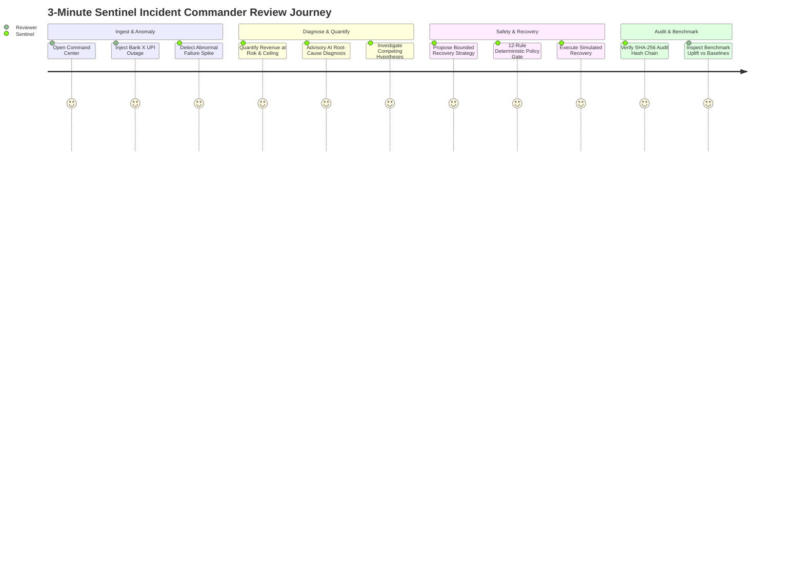

# Razorpay Sentinel — 3-Minute Judge Demonstration Guide

**Primary Interface Route**: [`/command-center`](http://localhost:3000/command-center)  
**Estimated Review Time**: 3 minutes  
**Goal**: Experience the full end-to-end incident recovery workflow from anomaly detection to cryptographic audit proof and empirical benchmark uplift.

---

## 1. Quick Setup & Launch

```bash
# Terminal 1: Start Backend (Spring Boot 3 / Java 17)
cd backend
mvn spring-boot:run

# Terminal 2: Start Frontend (Next.js 14 / Node)
cd frontend
npm run dev
```

Open your browser to: **`http://localhost:3000/command-center`**

---

## 2. Recommended 3-Minute Demo Walkthrough



### Step 1: Open the Flagship Command Center (0:00 – 0:30)
* Navigate to [`/command-center`](http://localhost:3000/command-center).
* Observe the **Subsystem Telemetry Header**: All core subsystems report operational health:
  - `AI Advisory Engine` (Schema validated)
  - `Deterministic Policy Gate` (12 rules active)
  - `Recovery Execution Simulator` (Circuit breakers active)
  - `Cryptographic Audit Chain` (SHA-256 verified)

---

### Step 2: 1-Click Guided Incident Commander Demo (0:30 – 1:30)
* In the **1-Click Guided Demo** panel, click **`Run Full Sentinel Demo Flow`**.
* Watch the end-to-end pipeline execute live in sequence:
  1. **Traffic Generation**: Synthesizes realistic multi-bank payment transactions.
  2. **Scenario Degradation**: Degrades Bank X UPI transactions with `GATEWAY_ERROR`.
  3. **Anomaly Detection**: Anomaly detector isolates a statistically significant failure rate jump (e.g. $+34.2\%$ failure surge).
  4. **Financial Quantification**: Calculates Total Revenue at Risk (e.g. ₹147,350) and Authoritative Recoverable Revenue (e.g. ₹112,350).
  5. **Advisory AI Diagnosis**: AI identifies `"Bank X UPI Gateway Downtime"` with high confidence ($92\%$) and `MEDIUM` risk.
  6. **Root-Cause Investigation**: Compares competing hypotheses against telemetry facts, finding overwhelming corroborating evidence on Bank X UPI.
  7. **Recovery Strategy Formulation**: Proposes `SWITCH_GATEWAY` / `DELAYED_RETRY` bounded by maximum 3 attempts and ₹112,350 ceiling.
  8. **Deterministic Policy Gate**: Evaluates against 12 hard safety rules $\to$ sets status to **`APPROVED WITH LIMITS`**.
  9. **Recovery Execution**: Simulates retry attempts within policy bounds $\to$ safely recovers **₹77,350.00**.
  10. **Audit Verification**: Validates SHA-256 cryptographic hash-chain integrity $\to$ **`AUDIT INTEGRITY: VERIFIED`**.

---

### Step 3: Inspect the Financial Impact Hero & Decision Pipeline (1:30 – 2:15)
* Review the **Financial Impact Hero** cards:
  - **Revenue at Risk**: Total incident exposure.
  - **Recoverable Revenue**: Authoritative mathematical ceiling.
  - **Revenue Recovered**: Actual simulated recovery outcome.
  - **Unrecovered / Protected Revenue**: Fraud/permanent failures safely not retried.
* Highlight the core mathematical invariant:
  $$\text{Actual Recovered Revenue} \le \text{Authoritative Recoverable Revenue} \le \text{Total Revenue at Risk}$$

---

### Step 4: Verify Safety Proofs & Benchmark Performance (2:15 – 3:00)
* Scroll to **Safety Invariant Proofs**:
  - `0` Policy Bypasses
  - `0` Bound Violations
  - `100%` Fail-Closed Posture
  - `100%` Audit Chain Integrity
* Review the **Live Benchmark Snapshot**:
  - Compare **Baseline A (No Recovery = ₹0)** vs **Baseline B (Naive Retry = ₹55,250 / 49.2%)** vs **Sentinel (₹77,350 / 68.8%)**.
  - Show the **+40.0% financial uplift** delivered by intelligent, policy-governed routing over blind retrying.
* Click **`View Full Evaluation →`** to navigate to [`/evaluation`](http://localhost:3000/evaluation) to inspect the full 4-quadrant benchmark console and per-incident audit breakdown.

---

## 3. Alternative Scenarios to Test (Optional)

1. **Merchant Degradation (Safety Gate Fail-Closed Demo)**:
   - Select `MERCHANT_SPECIFIC_DEGRADATION` from the Scenario Selector.
   - Click `Simulate Scenario`.
   - Run AI Diagnosis & Policy Gate $\to$ Sentinel identifies invalid merchant API key $\to$ Policy Gate sets decision to **`HUMAN_REVIEW / BLOCKED`** $\to$ Execution is safely aborted!
2. **Safety Lab**:
   - Navigate to [`/safety`](http://localhost:3000/safety) and click `Run All 12 Safety Scenarios` to see Sentinel prove safety under AI failure, JSON corruption, audit tampering, and circuit breaker trips.
