# Razorpay Sentinel — Technical Architecture & Subsystem Specification

---

## 1. Architectural Philosophy

Razorpay Sentinel is engineered as a **modular, production-style monolith** (Spring Boot 3 + Next.js 14). Detection, financial quantification, advisory AI diagnosis, root-cause investigation, deterministic policy gating, recovery simulation, and cryptographic audit all reside within a unified, traceable pipeline.

```mermaid
graph TB
    subgraph Frontend [Next.js 14 App Router]
        CC["/command-center (Unified Incident Control Room)"]
        DASH["/dashboard (Operations Overview)"]
        MON["/monitoring & /incidents"]
        EVAL["/evaluation (Benchmark Console)"]
        SAFE["/safety (Resilience Lab)"]
        PAY["/payments & /simulator"]
    end

    subgraph Backend [Spring Boot 3 Monolith]
        subgraph Controllers [REST API Layer /api/v1/*]
            C_MON[Monitoring & Incidents API]
            C_FIN[Financial Impact API]
            C_AI[AI Diagnosis & Investigation API]
            C_REC[Strategy & Execution API]
            C_POL[Deterministic Policy API]
            C_AUD[Audit & Hash-Chain API]
            C_EVAL[Evaluation & Benchmark API]
            C_SAFE[Safety Lab API]
        end

        subgraph CoreServices [Authoritative Domain Services]
            S_GEN[PaymentGeneratorService]
            S_SIM[IncidentSimulationService]
            S_DET[IncidentDetectionService]
            S_FIN[FinancialImpactService]
            S_AI[AiDiagnosticService]
            S_INV[IncidentInvestigationService]
            S_STR[RecoveryStrategyService]
            S_POL[PolicyEvaluationService]
            S_EXE[RecoveryExecutionService]
            S_AUD[AuditEventService & HashChain]
            S_SAFE[SafetyScenarioService]
            S_EVAL[EvaluationService]
        end

        subgraph Persistence [PostgreSQL & JPA Repositories]
            R_PAY[(payments)]
            R_INC[(incidents)]
            R_FIN[(financial_impacts)]
            R_AI[(ai_diagnoses)]
            R_INV[(incident_investigations)]
            R_STR[(recovery_strategies)]
            R_POL[(policy_evaluations)]
            R_EXE[(recovery_executions)]
            R_AUD[(audit_events)]
            R_EVAL[(evaluation_runs)]
        end
    end

    Frontend -->|HTTP / JSON| Controllers
    Controllers --> CoreServices
    CoreServices --> Persistence
```

---

## 2. Core Subsystem Responsibilities & Boundaries

| Subsystem Component | Authority Level | Primary Responsibility | Zero Bypass Guarantee |
|---|---|---|---|
| **Payment Generation Engine** | Authoritative | Generates realistic synthetic multi-bank traffic | Isolated synthetic environment |
| **Incident Simulation Engine** | Authoritative | Injects reproducible degradations with lossless reset | Non-destructive simulation |
| **Anomaly Detection Engine** | Authoritative | Multi-segment anomaly detection (Bank $\times$ Method $\times$ Merchant) | Root-cause left unset for AI |
| **Financial Impact Engine** | Authoritative | Calculates Total Revenue at Risk & Recoverable Revenue | Sets hard ceiling for recovery |
| **AI Diagnostic Agent** | Advisory | Explains root cause & confidence based on deterministic telemetry | Zero execution authority |
| **Evidence Investigation Engine** | Advisory | Evaluates competing hypotheses against observed database facts | Distinguishes facts from inference |
| **Recovery Strategy Engine** | Advisory | Formulates bounded proposals with stopping limits | Must be validated by policy |
| **Deterministic Policy Gate** | **Decisive Gate** | Evaluates 12 hard safety rules with zero AI calls | Complete fail-closed blocking |
| **Bounded Recovery Simulator** | Authoritative | Executes retries within policy limits; measures recovered ₹ | Refuses execution without policy approval |
| **Cryptographic Audit Trail** | Authoritative | Chronological SHA-256 hash-chain across all lifecycle events | Cryptographically tamper-evident |
| **Safety & Resilience Lab** | Authoritative | Exercises 12 controlled failure scenarios & 15 safety invariants | Proves fail-closed behavior |
| **Evaluation & Benchmark Engine** | Authoritative | Seeded multi-scenario benchmark against Baselines A & B | Objective Ground Truth comparison |
| **Unified Command Center** | Presentation | Flagship operational control room & 10-step Guided Demo runner | Pure composition layer |

---

## 3. Cryptographic SHA-256 Audit Chain Specification

Every incident lifecycle event is linked sequentially:

$$\text{Hash}_0 = \text{SHA-256}(\text{IncidentID} \parallel \text{"GENESIS"} \parallel \text{Timestamp})$$
$$\text{Hash}_n = \text{SHA-256}(\text{SequenceIndex} \parallel \text{Timestamp} \parallel \text{EventType} \parallel \text{PayloadHash} \parallel \text{Hash}_{n-1})$$

### Monitored Event Types:
1. `INCIDENT_DETECTED`
2. `FINANCIAL_IMPACT_CALCULATED`
3. `AI_DIAGNOSIS_REQUESTED`
4. `AI_DIAGNOSIS_COMPLETED`
5. `INVESTIGATION_COMPLETED`
6. `RECOVERY_STRATEGY_PROPOSED`
7. `POLICY_EVALUATION_COMPLETED`
8. `RECOVERY_EXECUTION_ATTEMPTED`
9. `RECOVERY_EXECUTION_COMPLETED`
10. `CIRCUIT_BREAKER_TRIGGERED`

Verification iterates through the event list, computing expected hashes from `prevHash` to prove that no database record has been tampered with or deleted.

---

## 4. Key Safety Invariants

- **`INVARIANT-001` (AI Non-Execution)**: AI outputs are strictly advisory; the recovery execution service directly checks policy evaluation records before processing.
- **`INVARIANT-002` (Policy Gate Enforcement)**: If `PolicyEvaluation.executionAllowed == false`, execution is rejected and throws `PolicyViolationException`.
- **`INVARIANT-003` (Financial Boundedness)**:
  $$\text{Actual Recovered Revenue} \le \text{Authoritative Recoverable Revenue} \le \text{Total Revenue at Risk}$$
- **`INVARIANT-004` (Circuit Breaker Protection)**: Execution halts immediately with `STOPPED_CIRCUIT_BREAKER` if downstream retry failure rate exceeds 50%.
- **`INVARIANT-005` (Strategy Freshness)**: Proposals older than 30 minutes are automatically rejected by `POLICY-009`.
- **`INVARIANT-006` (Idempotent Execution)**: Re-invoking execution for an already executed incident returns the original execution record without double-counting recovered revenue.
