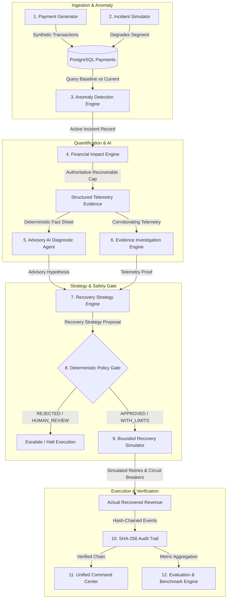

# End-to-End Payment Incident Working Flow

This document details the complete, chronological lifecycle of a payment incident within **Razorpay Sentinel: AI Payment Incident Commander**.

Sentinel enforces strict architectural boundaries at every stage:
$$\text{AI Proposes} \longrightarrow \text{Policy Decides} \longrightarrow \text{Recovery Executes} \longrightarrow \text{Audit Proves} \longrightarrow \text{Evaluation Benchmarks}$$

---

## 1. Complete Incident Lifecycle Overview

The primary incident response lifecycle moves through the following stages:

```
Traffic Ingestion → Incident Simulation → Anomaly Detection → Financial Quantification → AI Diagnosis → Evidence Investigation → Strategy Formulation → Policy Gate → Recovery Execution → Audit Verification → Benchmark Evaluation
```



---

## 2. Stage-by-Stage Operational Breakdown

### Stage 1: Synthetic Payment Generation
* **Subsystem**: Payment Generation Engine (`PaymentGeneratorService`, `PaymentRepository`)
* **Purpose**: Generates realistic, weighted synthetic payment traffic across multiple payment methods (UPI, Cards, NetBanking, Wallet), major Indian banks (HDFC, ICICI, SBI, Axis, Kotak), and error codes.
* **Input**: Transaction volume (e.g. 500 transactions), window duration (e.g. 48 hours), deterministic random seed.
* **Output**: Persisted `Payment` records in PostgreSQL.
* **Safety Boundary**: Zero real customer data or live bank connections; operates in a fully isolated synthetic environment.

---

### Stage 2: Controlled Incident Simulation
* **Subsystem**: Incident Simulation Engine (`IncidentSimulationService`)
* **Purpose**: Injects deterministic, reproducible payment degradations without permanently mutating baseline database history.
* **Supported Scenarios**:
  1. `BANK_X_UPI_DEGRADATION`: Replaces successful UPI transactions on Bank X with `GATEWAY_ERROR` / `BANK_DOWNTIME` to simulate an upstream bank outage.
  2. `MERCHANT_SPECIFIC_DEGRADATION`: Degrades transactions for a single merchant ID with `AUTH_FAILED` / `INVALID_API_KEY`.
  3. `NORMAL_RANDOM_FAILURES`: Distributes uniform random noise across all banks/methods (control scenario).
  4. `GATEWAY_TIMEOUT_DEGRADATION`: Injects elevated latency and `GATEWAY_TIMEOUT` errors.
* **Input**: Scenario type enum (`SimulationScenario`).
* **Output**: Modified payments marked with `SimulationChange` records for lossless reset.
* **Safety Boundary**: Idempotent reset support; non-destructive to underlying payment records.

---

### Stage 3: Real-Time Anomaly & Incident Detection
* **Subsystem**: Anomaly Detection Engine (`IncidentDetectionService`, `SegmentAnalyzer`)
* **Purpose**: Detects statistically abnormal failure rate surges across multidimensional segments (Bank $\times$ Method $\times$ Merchant) by comparing the current observation window against the historical baseline.
* **Input**: Window duration (e.g. 60 minutes), sensitivity thresholds (`sentinel.monitoring.thresholds.*`).
* **Output**: Persisted `Incident` entity (`status = DETECTED`, `severity = HIGH`, `failureRateDelta`, `affectedTransactions`).
* **Safety Boundary**: Duplicate suppression logic prevents alert fatigue by updating existing open incidents rather than spawning duplicates. Root cause is left strictly unset for downstream diagnostic validation.

---

### Stage 4: Authoritative Financial Quantification
* **Subsystem**: Financial Impact Engine (`FinancialImpactService`, `RecoverabilityClassifier`)
* **Purpose**: Quantifies financial exposure with strict mathematical rigor.
* **Input**: Open `Incident` entity and payment cohort in the incident time window.
* **Output**: `FinancialImpact` record detailing:
  - **Revenue at Risk (Exposure)**: Total value of all failed transactions during the incident.
  - **Authoritative Recoverable Revenue (Ceiling)**: Value weighted by empirical recoverability tiers (e.g. transient network timeouts have 70% recoverability; fraud/insufficient funds have 0% recoverability).
  - **Unrecoverable Revenue**: Fraudulent, invalid account, or permanent card declines.
* **Safety Boundary**: Mathematical Invariant:
  $$\text{Authoritative Recoverable Revenue} \le \text{Total Revenue at Risk}$$
  This engine is the sole authoritative financial source for downstream recovery ceilings.

---

### Stage 5: Advisory AI Diagnosis
* **Subsystem**: AI Diagnostic Agent (`AiDiagnosticService`, `MockAiProvider`, `GeminiAiProvider`)
* **Purpose**: Analyzes structured telemetry facts to produce an advisory explanation of the underlying incident.
* **Input**: Structured `IncidentEvidenceDto` containing factual failure rates, error code distribution, affected banks, and latency deltas.
* **Output**: Structured `AiDiagnosisResponse`:
  - Identified Root Cause (e.g. `"Bank X UPI Gateway Downtime"`)
  - Confidence Score ($0.00 - 1.00$)
  - Risk Level (`LOW`, `MEDIUM`, `HIGH`, `CRITICAL`)
  - Bounded Action Recommendation
* **Safety Boundary**:
  - **Advisory Only**: AI has zero execution permissions.
  - **Schema Enforcement**: Unparseable or malformed AI JSON is discarded; fails closed to safe fallback.
  - **Evidence Grounding**: AI is supplied only pre-computed deterministic facts—never raw prompts or uncontrolled context.

---

### Stage 6: Competing Root-Cause Investigation
* **Subsystem**: Evidence Investigation Engine (`IncidentInvestigationService`)
* **Purpose**: Systematically evaluates multiple competing hypotheses against actual telemetry to corroborate or refute the AI diagnosis.
* **Input**: Open `Incident` and segment statistics.
* **Output**: `InvestigationResultDto` containing:
  - Strongest Validated Hypothesis
  - Corroborating Evidence Points (e.g. failure rate jump restricted strictly to Bank X UPI)
  - Counter-Indicative Evidence (e.g. other banks' UPI success rates remain normal)
  - Final Root-Cause Verdict
* **Safety Boundary**: Strictly distinguishes observed database telemetry from inferred AI conclusions.

---

### Stage 7: Bounded Recovery Strategy Formulation
* **Subsystem**: Recovery Strategy Engine (`RecoveryStrategyService`)
* **Purpose**: Proposes an operational recovery strategy with explicit stopping limits and bounded recovery targets.
* **Supported Strategies**:
  - `SWITCH_GATEWAY`: Re-route traffic away from degraded upstream acquirer.
  - `DELAYED_RETRY`: Schedule retries with exponential backoff.
  - `IMMEDIATE_RETRY`: Quick retry for transient network drops.
  - `HUMAN_REVIEW`: Escalate to payment operations engineer.
  - `NO_ACTION`: Abort recovery when underlying issue is unrecoverable (e.g. merchant credential misconfiguration).
* **Input**: Validated diagnosis and authoritative financial impact.
* **Output**: `RecoveryStrategyProposal` with expected recovery amount, stopping conditions, max retry attempts, and backoff window.
* **Safety Boundary**: Proposals are bounded by authoritative recoverable revenue:
  $$\text{Expected Recovery Estimate} \le \text{Authoritative Recoverable Revenue}$$

---

### Stage 8: Deterministic Policy Gate Evaluation
* **Subsystem**: Deterministic Policy Gate (`PolicyEvaluationService`, Zero AI calls)
* **Purpose**: Evaluates proposed recovery strategies against **12 hard safety policies**.
* **12 Deterministic Policy Rules**:
  1. `POLICY-001`: Strategy Must Be Valid & Recognizable
  2. `POLICY-002`: Minimum Confidence Threshold ($\ge 0.70$ required for autonomous action)
  3. `POLICY-003`: Maximum Financial Exposure Limit ($\le \text{₹500,000}$)
  4. `POLICY-004`: Critical Risk Exclusion (CRITICAL risk forces `HUMAN_REVIEW`)
  5. `POLICY-005`: Merchant Protection Guard (Merchant degradation forces `HUMAN_REVIEW` / `REJECTED`)
  6. `POLICY-006`: Maximum Retry Attempt Limit (Enforces max 3 retries per payment)
  7. `POLICY-007`: Circuit Breaker Failure Threshold (Halt if consecutive failure rate $> 50\%$)
  8. `POLICY-008`: Active Incident State Verification (Cannot recover resolved/closed incidents)
  9. `POLICY-009`: Strategy Freshness Guard (Rejects proposals older than 30 minutes)
  10. `POLICY-010`: Recoverability Ceiling Enforcement ($\text{Recovery Bound} \le \text{Recoverable Revenue}$)
  11. `POLICY-011`: Action Whitelist Check (Only allowed actions permitted)
  12. `POLICY-012`: Human Review Escalation Compliance
* **Output**: `PolicyDecision` (`APPROVED`, `APPROVED_WITH_LIMITS`, `HUMAN_REVIEW`, `REJECTED`) and `appliedLimits`.
* **Safety Boundary**: Deterministic fail-closed gate. If any check fails or confidence is low, `executionAllowed = false`.

---

### Stage 9: Bounded Recovery Execution Simulation
* **Subsystem**: Recovery Execution Simulator (`RecoveryExecutionService`)
* **Purpose**: Simulates retry attempts for failed transactions strictly within policy-approved bounds.
* **Input**: Policy evaluation approval and target failed transaction cohort.
* **Output**: `RecoveryExecutionResult`:
  - `attemptedCount`, `successfulCount`, `failedCount`, `skippedCount`
  - **Actual Recovered Revenue (₹)**
  - Execution Status (`COMPLETED`, `STOPPED_CIRCUIT_BREAKER`, `SKIPPED`)
* **Safety Boundaries**:
  - **Mandatory Policy Check**: Execution aborts immediately if no valid `PolicyEvaluation` exists granting approval.
  - **Circuit Breaker**: Stops execution if consecutive failure rate exceeds 50%.
  - **Idempotency**: Repeated execution requests for the same incident return existing results without double-counting.
  - **Financial Cap**:
    $$\text{Actual Recovered Revenue} \le \text{Authoritative Recoverable Revenue} \le \text{Revenue at Risk}$$

---

### Stage 10: Cryptographic Audit Trail Logging
* **Subsystem**: Cryptographic Audit Trail Engine (`AuditEventService`, `AuditVerificationService`)
* **Purpose**: Records every proposal, decision, attempt, and outcome into a tamper-evident SHA-256 hash-chain.
* **Hash Formula**:
  $$\text{Hash}_n = \text{SHA-256}(\text{Index} \parallel \text{Timestamp} \parallel \text{EventType} \parallel \text{Payload} \parallel \text{Hash}_{n-1})$$
* **Output**: Chronological event timeline and cryptographic validation (`AUDIT INTEGRITY: VERIFIED`).
* **Safety Boundary**: Read-only verification detects any payload modification, row deletion, or sequence alteration.

---

### Stage 11: Controlled Safety & Resilience Validation
* **Subsystem**: Safety & Resilience Lab (`SafetyScenarioService`)
* **Purpose**: Deliberately executes **12 controlled failure scenarios** proving that Sentinel fails closed under adverse conditions:
  - AI downtime and network timeouts
  - Malformed or invalid JSON payloads
  - Low AI confidence scores ($< 0.70$)
  - Policy rejections and critical risk ratings
  - Merchant credential misconfigurations
  - Circuit breaker activation on downstream failure surges
  - Stale strategy proposals and resolved incident recovery attempts
  - Idempotency guards preventing double recovery
  - Cryptographic SHA-256 audit tampering detection

---

### Stage 12: Empirical Evaluation & Benchmarking
* **Subsystem**: Evaluation & Benchmarking Engine (`EvaluationService`, `EVAL_V1`)
* **Purpose**: Measures multi-incident performance against Ground Truth and baseline models (**Baseline A: No Recovery = ₹0** and **Baseline B: Naive Retry**).
* **Measured Dimensions**:
  1. Financial Effectiveness (Revenue Recovered, Recovery Rate %, Uplift vs Naive Retry %, Net Value Added).
  2. Detection & Latency (100% Detection Rate, 0% False Positive Rate, Mean TTD $\sim 140\text{ ms}$).
  3. Diagnostic & Strategy Accuracy (100% Root-Cause Accuracy, 100% Strategy Safety Precision).
  4. Policy & Safety Compliance (100% Policy Compliance, 0 Policy Bypasses, 0 Bound Violations, 100% Audit Integrity).

---

### Stage 13: Unified Incident Command Center Orchestration
* **Subsystem**: Flagship Final Command Center (`frontend/src/app/command-center/page.tsx`)
* **Purpose**: Consolidated operational control room presenting real-time telemetry, authoritative financial impact, 8-stage decision pipeline, 6-card diagnostic grid, safety proofs, and benchmark snapshots.
* **1-Click Guided Demo**: Automatically steps reviewers through Ingestion $\to$ Detection $\to$ Quantification $\to$ Diagnosis $\to$ Investigation $\to$ Strategy $\to$ Policy Gate $\to$ Recovery $\to$ Audit in under 30 seconds.
